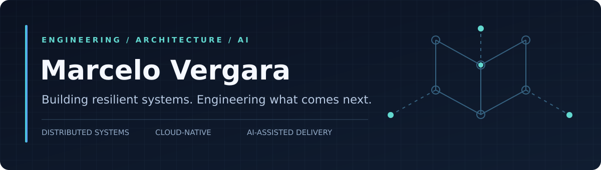
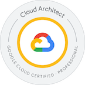
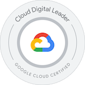
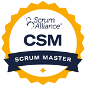

<!-- GitHub profile README | marcelorvergara/marcelorvergara -->

  

  <a href="https://mvergara.net"><strong>PORTFOLIO</strong></a>&nbsp;&nbsp;·&nbsp;&nbsp;
  <a href="https://www.linkedin.com/in/mvergara/"><strong>LINKEDIN</strong></a>&nbsp;&nbsp;·&nbsp;&nbsp;
  <a href="https://www.credly.com/users/mvergara/badges"><strong>CREDENTIALS</strong></a>&nbsp;&nbsp;·&nbsp;&nbsp;
  <a href="mailto:mrezendevergara@gmail.com"><strong>CONTACT</strong></a>

---

### The human in the circuit

I work at the intersection of **software architecture, enterprise systems, cloud engineering, and applied AI**. My focus is transforming complex technical environments into reliable, maintainable platforms — while helping engineering teams deliver with clarity and accountability.

My background spans **15+ years in software and IT**, including high-volume transactional systems, critical application support, distributed architectures, and technical leadership. Today, I combine established engineering practices with **AI-assisted development** — where automation accelerates delivery, but people remain accountable for design decisions, security, and production quality.

<table>
  <tr>
    <td width="33%" valign="top">
      <strong>01 / ARCHITECTURE</strong>  
      Distributed services, enterprise integration, system modernization, performance and reliability.
    </td>
    <td width="33%" valign="top">
      <strong>02 / CLOUD &amp; DELIVERY</strong>  
      Google Cloud, CI/CD, DevSecOps, observability and production-oriented engineering.
    </td>
    <td width="34%" valign="top">
      <strong>03 / APPLIED AI</strong>  
      Agentic coding workflows, specification-driven delivery, review and human-in-the-loop validation.
    </td>
  </tr>
</table>

### Selected work

| Project | What it demonstrates |
| :--- | :--- |
| **[Monitoring Links](https://monitoringlinks.com/)** | Availability monitoring, event-driven notifications, cloud deployment and service integrations. |
| **[Fábula Infantil](https://fabulainfantil.com/)** | A generative-AI product combining a web experience, APIs and cloud-hosted data. |
| **[Qual é o Bairro?](https://qualeobairro.com.br/)** | An interactive educational experience built around local geography and learning through play. |
| **[Explore my portfolio](https://mvergara.net/)** | Additional experience, engineering projects and technical background. |

### Professional certifications

  &nbsp;&nbsp;&nbsp;
  &nbsp;&nbsp;&nbsp;
  &nbsp;&nbsp;&nbsp;
  

Click any credential to open its verification page. Additional skills and certifications are available on <a href="https://www.credly.com/users/mvergara/badges">Credly</a>.

### Engineering toolkit

| Area | Technologies & practices |
| :--- | :--- |
| **Backend & integration** | Java, Spring Boot, Node.js, Python, REST APIs, microservices, asynchronous messaging |
| **Frontend** | TypeScript, Angular, React, RxJS |
| **Data platforms** | Oracle, PostgreSQL, MongoDB, Redis, OpenSearch |
| **Cloud & delivery** | Google Cloud, Docker, GitHub Actions, Jenkins, SonarQube, Checkmarx |
| **Observability** | Dynatrace, application performance monitoring, production diagnostics |
| **AI-assisted engineering** | Claude Code, Gemini, agent workflows, technical specifications, code review and testing |

> **Engineering principle:** Use AI to increase the quality and speed of engineering work — never to outsource responsibility for the result.

---

  <strong>Let's discuss resilient systems, cloud architecture and practical AI engineering.</strong>  
  <a href="https://www.linkedin.com/in/mvergara/">LinkedIn</a>&nbsp;&nbsp;·&nbsp;&nbsp;
  <a href="https://mvergara.net/">Portfolio</a>&nbsp;&nbsp;·&nbsp;&nbsp;
  <a href="mailto:mrezendevergara@gmail.com">Email</a>

